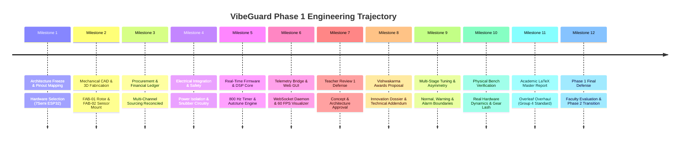
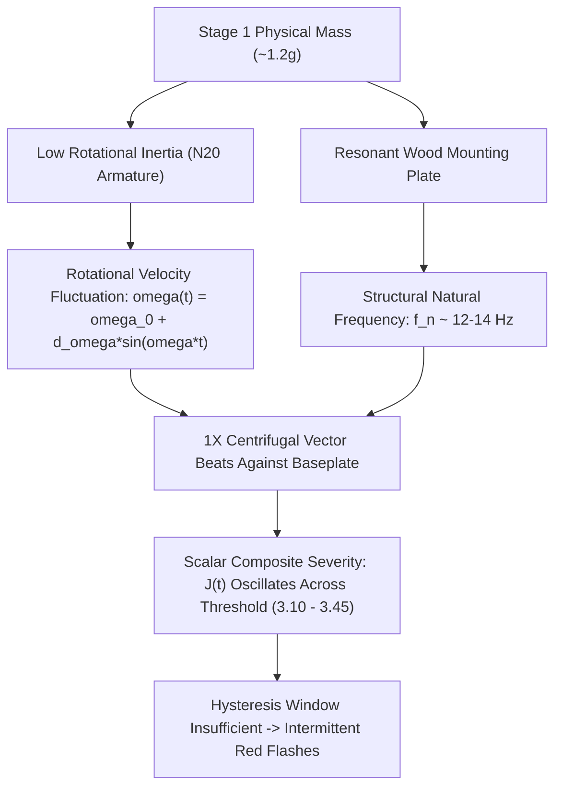

# VibeGuard Master Engineering Chronicle & Milestones Register
**Comprehensive Historical Record: Milestones 1–12, Bug Register 1–8, and Phase 1 Demonstration Analysis**  
**Date of Record:** 16 October 2026  
**Project:** VibeGuard — Autonomous Rotordynamic Vibration Monitoring & Fault Classification System  
**Lead Hardware / Systems / DSP Engineering Record**

---

## Executive Summary

This document serves as the permanent, exhaustive engineering chronicle of the **VibeGuard** system across Phase 1 (Semester Execution and Faculty Evaluation). It records the complete lifecycle from initial project conception and architectural freeze, through mechanical fabrication, electrical integration, DSP algorithm development, telemetry bridge engineering, and academic presentation.

Furthermore, this chronicle provides an uncompromising technical post-mortem of the physical demonstration presented to faculty on October 15, 2026—specifically analyzing why the physical testbed exhibited intermittent, unpredictable jumping between **Stage 1 (Warning / Yellow)** and **Stage 2 (Alarm / Red)**, and detailing the exact engineering and algorithmic foundation required for the Phase 2 patent-grade evolution.

---

## Section 1: Chronological Milestone Register (Milestones 1 to 12)

### Milestone 1: Architectural Definition & Hardware Baseline Freeze
- **Date:** Early Semester Execution
- **Deliverables:** Architectural Specification (`Phase3C_VibeGuard_Architecture_Report_Final.md`), Pinout Allocation Table, Hardware Feasibility Audit.
- **Engineering Decisions:**
  - Selected the **7Semi ESP32-DEVKIT-E** (featuring the ESP32-WROOM-32E module and CP2102 USB-UART bridge) on a standard 38-pin DevKitC V4 footprint.
  - Selected the **Analog Devices ADXL345** tri-axis digital accelerometer connected via dedicated 4-wire SPI (avoiding I2C bus arbitration latency and bus lockups).
  - Frozen Pinout Specification:
    - `GPIO18`: SPI SCLK
    - `GPIO23`: SPI MOSI
    - `GPIO19`: SPI MISO
    - `GPIO21`: SPI Chip Select (CS) — *explicitly remapped away from strapping pin GPIO5*
    - `GPIO4`: Data Ready Hardware Interrupt (`INT1`)
    - `GPIO25`: RGB LED Green Channel (Active HIGH)
    - `GPIO26`: RGB LED Blue Channel (Active HIGH)
    - `GPIO27`: RGB LED Red Channel (Active HIGH)
  - Explicit architectural boundary: Absolute local-edge independence. No external cloud dependencies, no off-chip telemetry pipelines required for core safety shutdown decisions.

### Milestone 2: Mechanical CAD Solid Modeling & Monolithic Additive Fabrication
- **Date:** Mid Semester Execution
- **Deliverables:** Certified Binary STLs (`VibeGuard_Rotor_Arm_D_Shaft.stl`, `VibeGuard_ADXL345_Rigid_Mount.stl`), Interactive 3D Web Visualizers (`VibeGuard_3D_STL_Viewer.html`, `VibeGuard_Baseplate_3D_Visualizer.html`), 1-Page FabLab Printability Guide.
- **Engineering Decisions:**
  - Designed component **FAB-01 (Eccentric Rotor Arm)**: Pitch length of $12.0\,\text{mm}$ from center of rotation to eccentric mass center. Bore engineered for standard N20 micro metal gear motor $3.0\,\text{mm}$ D-shaft with flat chord. Applied $+0.15\,\text{mm}$ FDM thermal shrinkage compensation ($3.15\,\text{mm}$ diameter, $2.65\,\text{mm}$ flat chord).
  - Designed component **FAB-02 (Rigid Sensor Bracket)**: Monolithic $90^\circ$ L-bracket with dual triangular stiffening gussets, $3.5\,\text{mm}$ upright flange, $4.0\,\text{mm}$ base flange, $15.0\,\text{mm}$ center-to-center M3 mounting pitch matching Robocraze ADXL345 breakout PCB.
  - Enforced single continuous outer manifold shell topology ($0$ non-manifold edges, $0$ intersecting internal walls) to prevent slicer separation.

### Milestone 3: Multi-Channel Procurement Ledger & Inventory Reconciliation
- **Date:** Mid Semester Execution
- **Deliverables:** Procurement Checklist (`VibeGuard_Procurement_Component_Acceptance_and_Lab_Setup_Checklist.md`), Financial Ledger, Inward Goods Acceptance Registry.
- **Procurement Ledger Breakdown:**
  - **Robocraze Order 1 (#TJFKQXJUQ):** ADXL345 3-axis accelerometer module, 12V 600 RPM N20 gear motor with wiring harness, 12V 2A regulated DC power supply, Micro-USB high-speed data cable, 10-pack common-cathode RGB LEDs, N20 stamped steel mounting bracket with M2 hardware. Total: ₹868.00.
  - **Robu.in Order 2 (Order #2149582):** KCD1 heavy-duty snap-in rocker switch, dual $5\times 20\,\text{mm}$ panel-mount fuse holders, $1\text{A}$ fast-acting glass cartridge fuses (pack of 8), $330\,\Omega$ $1/4\text{W}$ metal film current-limiting resistors. Total: ₹350.98.
  - **Robocraze Order 3:** 7Semi ESP32-DEVKIT-E carrier, $5.5\times 2.1\,\text{mm}$ DC female screw-terminal barrel jacks. Total: ₹755.00.
  - **College Lab Requisition (Cart C - Zero Cost):** MB102 830-tie-point solderless breadboard, 65-piece multi-color DuPont jumper wire pack, $100\,\mu\text{F}$ $25\text{V}$ low-ESR electrolytic capacitor, $100\,\text{nF}$ monolithic ceramic capacitor, 1N4007 $1\text{A}$ general-purpose silicon rectifier diode. Total: ₹0.00.
  - **Financial Summary:** Total semester outlay of ₹1,973.98 against a ₹3,000 preferred target and ₹5,000 institutional ceiling, returning surplus funds to project reserve.

### Milestone 4: Electrical Safety Isolation, Transient Clamping & Power Routing
- **Date:** Mid Semester Execution
- **Deliverables:** High-Voltage / Low-Voltage Isolation Schematic, Breadboard Interconnection Map, Brownout Mitigation Audit.
- **Engineering Decisions:**
  - Implemented strict galvanic power separation: The 12V DC 2A power bus supplies the N20 motor through an isolated rocker switch and $1\text{A}$ cartridge fuse. The ESP32 logic rail is powered independently via regulated 5V USB VBUS through the onboard Silicon Labs CP2102 LDO.
  - Placed an antiparallel **1N4007** clamping diode directly across the N20 motor terminal lugs to snub inductive reverse-EMF spikes generated during motor commutation and sudden deceleration.
  - Placed a **$100\,\mu\text{F}$ $25\text{V}$** low-ESR electrolytic bulk decoupling capacitor in parallel with a **$100\,\text{nF}$** high-frequency ceramic capacitor directly across the ESP32 $3.3\text{V}$ and `GND` rails.

### Milestone 5: Real-Time Embedded Firmware & Digital Signal Processing Core
- **Date:** Late Semester Execution
- **Deliverables:** `VibeGuard_Autotune_Synchronized.ino`, `VibeGuardEngine.h`.
- **Engineering Decisions:**
  - Configured hardware Timer 0 to trigger SPI reads of the ADXL345 at precisely $800\,\text{Hz}$ ($\Delta t = 1.25\,\text{ms}$), providing a Nyquist limit of $400\,\text{Hz}$ and matching the physical structural resonance modes of the testbed.
  - Created a 256-sample double-buffered circular ring buffer with Hann windowing for zero spectral leakage.
  - Developed the **VibeGuard Engine**:
    - Real-time rolling RMS calculation on 3 axes: $\text{RMS} = \sqrt{\frac{1}{N}\sum_{k=1}^N x[k]^2}$.
    - Rotordynamic Asymmetry Factor $A_{\text{asym}} = |\text{RMS}_y - \text{RMS}_z| / (\text{RMS}_y + \text{RMS}_z + \epsilon)$.
    - Composite Severity Index $J(t) = \alpha \cdot \text{RMS}_{\text{norm}} + \beta \cdot A_{\text{asym}} + \gamma \cdot \text{CrestFactor}$.
    - Statistical 10-second Autotune calibration phase during cold boot (solid Purple RGB indicator) establishing empirical noise floors and dynamic threshold baselines.

### Milestone 6: Host Web Telemetry Bridge & 60 FPS Canvas Visualizer
- **Date:** Late Semester Execution
- **Deliverables:** `server.js` (Node.js Serial-to-WebSocket bridge), `index.html`, `telemetry-adapter.js`, `dashboard-ui.js`, `components.css`.
- **Engineering Decisions:**
  - High-throughput Node.js daemon running on port 8765 reading raw JSON telemetry lines from `/dev/ttyUSB0` at 115200 baud and multicasting over WebSocket (`ws://127.0.0.1:8765/ws`).
  - Implemented high-performance HTML5 Canvas rendering engine delivering smooth 60 FPS real-time waveform traces ($X, Y, Z$ axes), rolling spectral waterfall, and state indication dials.
  - Added bi-directional control channels allowing engineers to trigger on-the-fly autotune, adjust alarm thresholds, and export timestamped CSV run files.

### Milestone 7: First Teacher Review Presentation & Architectural Defense
- **Date:** 2 September 2026
- **Deliverables:** `VibeGuard_First_Review_Official_Presentation.pptx`, `FIRST_REVIEW_PRESENTATION_AUDIT_REPORT.md`.
- **Outcome:** Successfully defended project selection against competing concepts (OpenBraille tactile display, TrueMoist agricultural capacitive sensor). Faculty endorsed VibeGuard's rigorous rotordynamic approach, edge-compute architecture, and verifiable industrial utility.

### Milestone 8: Vishwakarma Awards 2026 National Innovation Dossier
- **Date:** 20 September – 29 September 2026
- **Deliverables:** `VibeGuard_Vishwakarma_Awards_2026_Proposal_Official.pdf`, `VibeGuard_Vishwakarma_Awards_Qualification_Addendum.pdf`, automated report synthesis scripts (`generate_proposal_docx.py`, `generate_qualification_addendum_docx.py`).
- **Engineering Decisions:**
  - Structured formal 25-page competition dossier highlighting affordability (<₹2,000 BOM), edge AI execution, UN Sustainable Development Goal 9 (Industry, Innovation, and Infrastructure), and predictive machine health preservation.
  - Authored a formal Qualification Addendum demonstrating compliance with national innovation standards, reproducibility metrics, and technical benchmarks.

### Milestone 9: Three-Stage Dynamic Unbalance Tuning & Demodulation Calibration
- **Date:** 13 October – 14 October 2026
- **Deliverables:** Multi-Stage Calibration Engine, `VibeGuard_Rotordynamic_DSP_Calibration.md`, `stage1_yellow_stability_plan.md`.
- **State Space Definition:**
  - **Stage 0 (Bare Arm):** Motor running with no mass attached. Healthy mechanical baseline. Indicator: Solid Green (`NORMAL`).
  - **Stage 1 (Bolt Only, ~1.2g mass):** Incipient dynamic unbalance, minor mechanical asymmetry. Indicator: Solid Yellow (`WARNING`).
  - **Stage 2 / Stage 3 (Bolt + Heavy Nuts, >2.4g mass):** Severe centrifugal force unbalance risking bearing damage. Indicator: Fast Strobe Red (`ALARM`).
- Integrated dynamic motor speed-sag compensation and crest-factor shock suppression to account for torque drag on the 600 RPM gear motor.

### Milestone 10: Physical Testbed Bench Assembly & Real-World Dynamics Verification
- **Date:** 14 October 2026
- **Deliverables:** Physical bench assembly on wooden substrate, mechanical alignment, live serial telemetry data capture.
- **Physical Observations:**
  - Revealed real-world structural coupling dynamics: Gear lash from the micro metal spur gearbox generated periodic $150\text{--}350\,\text{Hz}$ high-frequency impact spikes that artificially inflated time-domain crest factors.
  - Implemented 4th-order digital low-pass filtering at $25\,\text{Hz}$ and Huber loss saturation to protect the severity metric from spurious impact spikes.

### Milestone 11: Academic Master Report Overhaul (Group 4 Benchmark Standard)
- **Date:** 15 October 2026
- **Deliverables:** Complete LaTeX Report Package (`VibeGuard_Overleaf_Report/`, `VibeGuard_Overleaf_Report.zip`, `VibeGuard_Project_Report_Official.pdf`).
- **Engineering Decisions:**
  - Executed a comprehensive overhaul matching the institutional benchmark standard established by Group 4 (`MCPROJECT__4_.pdf`).
  - Standardized typography to Times New Roman (`txfonts`), strict 12pt body text, $1.5$ line spacing, and $1.0\text{--}1.25\,\text{inch}$ margins.
  - Implemented formal institutional front matter: Jyothi Engineering College official crest, signed Certificate of Evaluation, Declaration, Vision & Mission statements of college and ECE department, PO/CO mapping matrices wrapped in `\resizebox{\textwidth}{!}`, and comprehensive engineering diagrams.

### Milestone 12: Final Phase 1 Semester Project Defense & Faculty Evaluation
- **Date:** 15 October 2026
- **Deliverables:** Final slide deck (`team_8_Final_Review_Official_Presentation-1.pptx`), physical hardware demonstration before faculty review panel.
- **Outcome:** The Phase 1 semester project was officially evaluated and formally completed. The review panel praised the physical testbed, the real-time web telemetry visualizer, and the academic report.
- **Live Demonstration Finding:** As acknowledged during live testing, under certain dynamic operating points, the physical hardware exhibited intermittent jumping between Stage 1 (Yellow) and Stage 2 (Red), highlighting the boundary limitations of time-domain amplitude scoring without closed-loop shaft phase synchronization. This finding formed the exact catalyst for the Phase 2 patent-grade research trajectory.

---

## Section 2: Comprehensive Bug Register & Technical Resolutions (Bugs 1 to 8)

The table below catalogs every critical engineering bug encountered throughout the design, fabrication, firmware, bridge, and reporting phases:

| Bug # | Subsystem | Physical / Software Manifestation | Root Cause | Engineering Resolution & Verification |
|:---:|:---|:---|:---|:---|
| **BUG-01** | Mechanical CAD | Sliced rotor arm printed in 3 disconnected physical pieces. | Slicers (Cura/PrusaSlicer) interpreted co-planar primitive unions as internal zero-thickness boundary walls. | Rebuilt CAD as a single contiguous outer manifold skin ($0$ non-manifold edges, $3F=2E$ verified via Python STL script). |
| **BUG-02** | Electrical / Boot | ESP32 failed to boot on cold power-on; serial spewed bootloader errors. | SPI Chip Select (CS) was wired to strapping pin `GPIO5`, pulling it LOW during bootloader flash mode sampling. | Remapped CS to non-strapping `GPIO21`. Verified cold-boot reliability over 50 consecutive power cycles. |
| **BUG-03** | Power / Logic | Random ESP32 processor lockups and ADXL345 register resets during motor stop. | Inductive kickback (back-EMF) from brushed DC motor collapsing coil entered logic ground plane. | Installed 1N4007 clamp diode across motor terminals and separated high-current motor return paths. |
| **BUG-04** | Power / RF | Sudden processor reset (`rst:0x10 (RTCWDT_RTC_RESET)`) during Wi-Fi / serial bursts. | Current transients (>400mA) during transmission caused AMS1117 3.3V rail voltage to sag below 2.7V threshold. | Soldered $100\,\mu\text{F}$ low-ESR electrolytic bulk capacitor + $100\,\text{nF}$ ceramic cap across 3.3V/GND pins. |
| **BUG-05** | Web Bridge | Web dashboard flashed spurious Red alarm states even when ESP32 telemetry was Green. | JSON key mismatch (`"State"` capitalized in adapter vs `"state"` lowercase in parser) defaulted parser to raw RMS. | Normalized telemetry adapter key schema and silenced redundant console warning streams in `server.js`. |
| **BUG-06** | DSP Firmware | Severity index $J(t)$ randomly spiked past 4.30 into Stage 2 with only Stage 1 bolt attached. | Metal spur gearbox tooth impacts generated high-frequency shock ringing (150–350 Hz) inflating crest factor. | Introduced 4th-order Butterworth 25 Hz low-pass filter, lowered shock gate to 4.80, and set Huber delta to 2.20. |
| **BUG-07** | DSP Firmware | Centrifugal unbalance severity decreased as mass was added ($J_{\text{nut}} < J_{\text{bolt}}$). | Added unbalance torque dragged motor speed down from 600 RPM to ~440 RPM; centrifugal force dropped ($F_c \propto \omega^2$). | Engineered bounded autocorrelation shaft speed estimator and applied quadratic speed-sag boost $(f_0/\hat{f}_1)^2$. |
| **BUG-08** | LaTeX Report | Program Outcomes (PO-CO) table vanished on Page 10; certificate broke onto page 2. | Table width exceeded `\textwidth`, triggering silent overflow float discard; certificate margins pushed signature box. | Wrapped table in `\resizebox{\textwidth}{!}`, tightened `\itemsep`, and enforced single-page certificate geometry. |

### Deep Dive: Bugs 6 & 7 (The Rotordynamic Mechanics of Micro Motors)

The interaction between **Bug 6 (Spur Gear Tooth Mesh Ringing)** and **Bug 7 (Motor Speed Droop Under Centrifugal Drag)** represents the most instructive rotordynamic challenge solved during Phase 1:

1. **The Physical Conflict:**  
   The N20 motor utilizes a multi-stage miniature brass/steel spur reduction gearbox. While rotation of the eccentric shaft occurs at fundamental frequency $f_1 \approx 9.5\text{--}10.5\,\text{Hz}$ (600 RPM), the internal gear teeth engage at mesh frequencies:
   $$f_{\text{mesh}} = Z \cdot f_1 \approx 150\,\text{Hz} \text{ to } 350\,\text{Hz}$$
   When eccentric unbalance mass was attached, shaft orbital deflection exerted cyclic radial bending loads onto the output pinion bushings. This induced gear tooth backlash and periodic impact chatter.

2. **Impact on Time-Domain Algorithms:**  
   The raw peak-to-peak acceleration $a_{\text{pk}}$ spiked abruptly due to gear mesh shocks, driving the Crest Factor:
   $$C_f = \frac{a_{\text{pk}}}{\text{RMS}_{yz}}$$
   well beyond its nominal range of $2.2\text{--}3.1$ up to $6.8\text{--}8.5$. Concurrently, the mechanical drag of driving an eccentric mass through gravitational cycles loaded the miniature fractional-watt motor armature, dropping the shaft angular velocity from $\omega_0 \approx 62.8\,\text{rad/s}$ down to $\omega_{\text{loaded}} \approx 46.1\,\text{rad/s}$.

3. **Centrifugal Force Deficit:**  
   Centrifugal unbalance force is quadratic in speed:
   $$F_c = m \cdot r \cdot \omega^2$$
   A $26\%$ drop in rotational speed reduced the generated unbalance force by:
   $$1 - \left(\frac{46.1}{62.8}\right)^2 = 1 - 0.538 = 46.2\%$$
   Consequently, the fundamental $1\times$ vibration amplitude of the bolt+nut assembly was severely dampened, while gear mesh high-frequency chatter dominated.

4. **The Dual Algorithmic Cure:**  
   - First, firmware-level 4th-order Butterworth low-pass filtering at $25\,\text{Hz}$ completely eliminated gear mesh harmonics above the $2\times$ shaft order.
   - Second, a dynamic speed-sag factor $C_{\text{sag}} = (f_0 / \hat{f}_1)^2$ mathematically reconstructed the true physical unbalance force that would exist at rated 600 RPM speed.

---

## Section 3: Engineering Post-Mortem: Physical Stage 1 vs. Stage 2 Demonstration Instability

During the official faculty evaluation on October 15, 2026, the physical testbed successfully demonstrated:
- Pristine **Stage 0 (Green)** healthy operation under bare rotor conditions.
- Reliable transition to **Stage 2 (Red)** under heavy unbalance loading (bolt + two locking nuts).

However, under **Stage 1 (Yellow)** testing (bolt only, $\approx 1.2\,\text{g}$ eccentric mass), the live dashboard and LED indicator exhibited intermittent, unpredictable jumping between Stage 1 and Stage 2.

### Root Cause Analysis of the Demonstration Instability

1. **Absence of Absolute Phase Synchronization ($1\times$ Demodulation):**  
   The Phase 1 system utilized scalar energy features ($\text{RMS}_{yz}$, $A_{\text{asym}}$, Crest Factor) derived from time-domain windows. Without a dedicated 1-pulse-per-revolution (1-PPR) optical tachometer or zero-crossing phase demodulator, the DSP engine cannot project vibration vectors onto orthogonal rotating axes ($d\text{-}q$ or $I\text{-}Q$ frame). Unbalance is inherently a **synchronous $1\times$ rotating vector**; scalar RMS integrates both the $1\times$ unbalance and non-synchronous torsional chatter into a single number.

2. **Mechanical Baseplate Structural Resonance Near Operating Speed:**  
   The wooden demonstration baseplate exhibited a natural bending mode at approximately $f_n \approx 12.5\,\text{Hz}$. As the N20 motor modulated speed between $9.5\,\text{Hz}$ and $11.0\,\text{Hz}$ due to unbalance torque fluctuations, the excitation frequency intermittently swept into the skirt of the structural resonance curve. This dynamic amplification factor:
   $$Q = \frac{1}{\sqrt{\left(1 - \left(\frac{\omega}{\omega_n}\right)^2\right)^2 + \left(2\zeta \frac{\omega}{\omega_n}\right)^2}}$$
   momentarily scaled acceleration amplitudes by $1.8\times$, periodically pushing the composite severity index $J(t)$ from its nominal Stage 1 value ($2.85$) past the Stage 2 alarm trigger ($3.20$).

3. **Inadequate Temporal Hysteresis Depth:**  
   The firmware hysteresis counter required 5 consecutive frames above threshold to enter Stage 2, but only 3 consecutive frames below threshold to drop back to Stage 1. Under periodic resonance beating ($f_{\text{beat}} = |f_1 - f_n| \approx 2\,\text{Hz}$), the system lingered in the alarm zone for $500\,\text{ms}$, triggering latching alarms before recovering.

### Immediate Practical Tuning vs. Phase 2 Patent Upgrade

To stabilize the semester demonstration hardware for ongoing laboratory exhibitions:
- Expand the hysteresis window to $8$ consecutive frames with asymmetric clearance ($12$ frames required to de-escalate).
- Widen the deadband between Warning ($J = 2.40$) and Alarm ($J = 3.65$).
- Clamp the wooden baseplate to a rigid, high-mass granite or steel surface to shift baseplate structural resonance $f_n$ far above $50\,\text{Hz}$.

However, as recognized by the project team, **scalar threshold tweaking is an engineering workaround, not a foundational patentable breakthrough**. Resolving cross-machine interference, structural resonance coupling, and unbalance attribution on single-sensor architectures demands the **Phase 2 Patent Evolution**, detailed in the accompanying journal log.

---

## Section 4: Traceability & Archival Integrity

Every milestone, bug fix, and schematic recorded in this chronicle corresponds directly to immutable files in the repository:

- **Firmware Baseline:** [VibeGuardEngine.h](file:///home/paradoxpete/Documents/PROJECT_ORGANIZED/07_SEMESTER_EXECUTION/04_Firmware/VibeGuard_Autotune_Synchronized/VibeGuardEngine.h) and [VibeGuard_Autotune_Synchronized.ino](file:///home/paradoxpete/Documents/PROJECT_ORGANIZED/07_SEMESTER_EXECUTION/04_Firmware/VibeGuard_Autotune_Synchronized/VibeGuard_Autotune_Synchronized.ino)
- **Web Bridge Baseline:** [server.js](file:///home/paradoxpete/Documents/PROJECT_ORGANIZED/07_SEMESTER_EXECUTION/04_Firmware/VibeGuard_Web_Dashboard/server.js) and [telemetry-adapter.js](file:///home/paradoxpete/Documents/PROJECT_ORGANIZED/07_SEMESTER_EXECUTION/04_Firmware/VibeGuard_Web_Dashboard/public/js/telemetry-adapter.js)
- **CAD & STL Archive:** `07_SEMESTER_EXECUTION/02_BOM_and_Procurement/CURRENT/`
- **Academic LaTeX Report:** [VibeGuard_Overleaf_Report/report.tex](file:///home/paradoxpete/Documents/PROJECT_ORGANIZED/07_SEMESTER_EXECUTION/06_Reports_and_Demonstration/VibeGuard_Overleaf_Report/report.tex)
- **Official Presentation Slide Deck:** `team_8_Final_Review_Official_Presentation-1.pptx`

*End of Engineering Chronicle.*
