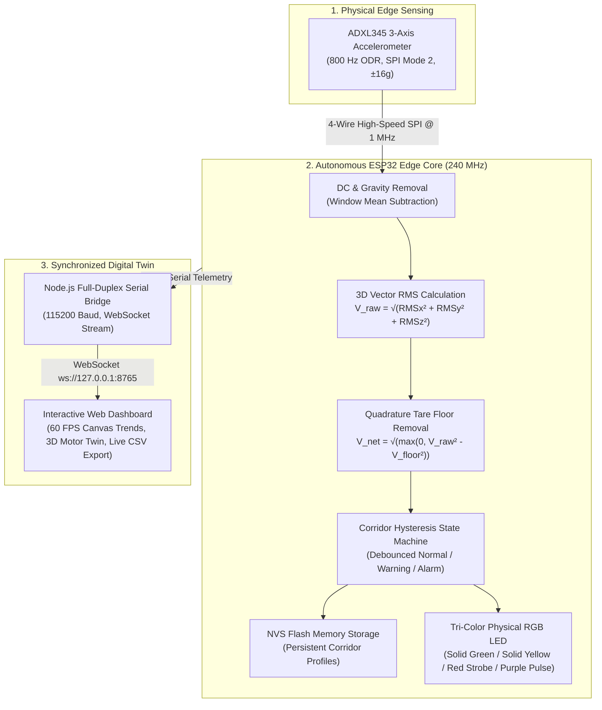

# VIBEGUARD: Autonomous Edge-AI Rotordynamic Vibration Monitoring & Fault Diagnostic System
## Master Source Document for Project Expo Exhibition Chart & Infographic Generation

> **Document Type:** Master Expo Exhibition Source Dossier & Infographic Blueprint  
> **Target Audience:** Google NotebookLM / Gemini Advanced (Infographic & Summary Synthesizer) & Archa Pramod (Poster Design & Illustration Lead)  
> **Project Title:** VibeGuard — Low-Cost Edge-Computing Vibration Anomaly Detector & Rotordynamic Diagnostic Testbed  
> **Academic Program:** B.Tech Capstone Project (Semester 7 Execution), Department of Computer Science & Engineering  
> **Institution:** APJ Abdul Kalam Technological University (KTU), Kerala, India  
> **Academic Year:** 2026  

---

## Panel 1: Project Identity & Header Banner

### 1.1 Project Headline & Slogan
* **Headline:** **VIBEGUARD: Edge-Computing Autonomous Vibration Condition Monitoring System**
* **Catchy Slogan:** *"Predictive Maintenance at 4% of Industrial Cost — True Physics-Based Edge Intelligence on an ESP32"*
* **Key Innovation:** Real-time 800 Hz edge DSP, physics-based Quadrature Tare noise rejection, interactive classroom field calibration, and synchronized digital-twin telemetry.

### 1.2 Team & Institutional Credits
| Role | Name | Primary Project Responsibility |
| :--- | :--- | :--- |
| **Team Lead / Integration Lead** | **Nihad P C** | System Architecture, Full-Stack Telemetry Bridge & Technical Integration |
| **Firmware & DSP Lead** | **Sreehari K** | Embedded C++ Firmware, Real-Time DSP Pipeline & NVS Flash Storage |
| **Hardware & Rig Lead** | **Amith Krishna Das** | Mechanical Assembly, Electrical Safety Isolation & Power Distribution |
| **Operations & Test Lead** | **Sreeprada K S** | Experimental Calibration Protocol, Inventory & Dynamic Stage Testing |
| **Documentation & Expo Lead** | **Archa Pramod** | Infographic Design, Academic Documentation & Demonstration Delivery |
| **Faculty Project Mentor** | **Ms. Sagna L T** | Assistant Professor, Department of Computer Science & Engineering |

---

## Panel 2: Problem Statement & Industrial Motivation

### 2.1 The Critical Industrial Challenge
* **Unplanned Downtime Crisis:** In modern manufacturing, paper mills, thermal power plants, and petrochemical refineries, unexpected mechanical breakdown of rotating equipment (motors, pumps, blowers, gearboxes) costs global industry over **$50 Billion annually**.
* **Rotordynamic Imbalance as Root Cause:** Mechanical mass imbalance accounts for **over 50% of all rotating machinery failures**. Left undetected, microscopic unbalance induces cyclical shear stress, accelerates bearing spalling, damages shaft seals, and ultimately triggers catastrophic structural rotor seizure.

### 2.2 The Market Dilemma: Why Existing Solutions Fail
1. **Commercial Systems are Prohibitively Expensive:** Traditional piezoelectric accelerometer suites (e.g., SKF Multilog, Bently Nevada, Fluke 810) cost between **₹50,000 and ₹2,50,000 ($600 – $3,000+)** per monitored axis. This places continuous 24/7 condition monitoring completely out of reach for Small and Medium Enterprises (SMEs), university laboratories, and auxiliary machinery.
2. **Naive IoT Sensors Produce False Alarms:** Cheap hobbyist vibration sensors simply send raw accelerometer data to the cloud. When placed in real-world environments (such as a vibrating table, classroom bench, or noisy workshop floor), ambient structural vibration and table resonances contaminate the signal. This causes naive threshold systems to trigger false alarms or flip erratically between "Warning" and "Alarm".
3. **Cloud Latency & Network Vulnerability:** Cloud-dependent vibration monitors fail when network connectivity drops. Critical machine shutdowns require **sub-10 millisecond edge determinism**, not remote cloud round-trips.

---

## Panel 3: The VibeGuard Solution & Core Innovations



### 3.1 Five Pillars of VibeGuard Innovation
1. **True Edge-Autonomous Intelligence:** All filtering, statistical mathematics, and emergency state triage occur entirely on the dual-core ESP32 microcontroller in **under 3 milliseconds**. Zero cloud dependency.
2. **Physics-Based Quadrature Tare:** Eliminates ambient environmental vibration (floor rumble, desk bumps, structural table resonance) using root-difference-of-squares vector math ($V_{\text{net}} = \sqrt{V_{\text{raw}}^2 - V_{\text{floor}}^2}$).
3. **Interactive 15-Second Rapid Field Calibration Suite:** A 4-stage empirical commissioning system built into the dashboard. Allows instant calibration on any unknown surface (Bare Arm $\to$ Bolt Only $\to$ Bolt + Nut) with a 3-second safety floor and Welford $O(1)$ streaming accumulation.
4. **Persistent On-Chip Flash Corridors (NVS):** Stores calibrated threshold corridors permanently into the ESP32’s flash memory. When unplugged and moved from the workbench to an exhibition hall, the system powers up with all calibrations intact.
5. **Real-Time Synchronized Digital Twin:** Web-based supervisory dashboard featuring real-time 60 FPS vector RMS charts, animated 3D SVG physical motor twin, directional X/Y/Z distribution bars, and ISO-standard safety event logging.

---

## Panel 4: Mechanical & Hardware Testbed Rig

```
                       [RIG TOPOLOGY ILLUSTRATION]
    =================================================================
    |  [Transparent Acrylic Baseplate: 5 mm Laser-Cut Acrylic]     |
    |                                                               |
    |      +-------------------------------------------+            |
    |      |  N20 DC Micro Metal Gear Motor (12V)      |            |
    |      |  [Rigid Stamped Steel Mounting Bracket]   |            |
    |      +-------------------------------------------+            |
    |                           |                                   |
    |                           v 3.0 mm D-Shaft                    |
    |              +--------------------------+                     |
    |              | FAB-01 Eccentric Rotor   |                     |
    |              | Arm (12.0 mm Pitch)      |                     |
    |              | [O] Stage 0: Bare Arm    |                     |
    |              | [*] Stage 1: +Bolt (2.5g)|                     |
    |              | [@] Stage 2: +Nut (3.4g) |                     |
    |              +--------------------------+                     |
    |                           |                                   |
    |         Vibration Wave Propagation Across Acrylic Body        |
    |                           |                                   |
    |                           v                                   |
    |      +-------------------------------------------+            |
    |      | FAB-02 Monolithic Sensor Bracket (PETG)   |            |
    |      | [Dual 90° Stiffening Gussets, M3 Pitch]   |            |
    |      |  ==> Analog Devices ADXL345 (SPI 4-Wire)  |            |
    |      +-------------------------------------------+            |
    |                                                               |
    |      +-------------------------------------------+            |
    |      | 7Semi ESP32-DEVKIT-E Microcontroller      |            |
    |      | + Common-Cathode Tri-Color Status RGB LED |            |
    |      +-------------------------------------------+            |
    =================================================================
```

### 4.1 Custom Fabricated Additive Parts
* **Component FAB-01 — Eccentric Rotor Arm:**
  * Material: High-infill PLA / PETG with $+0.15\,\text{mm}$ thermal shrinkage compensation.
  * Geometry: Engineered specifically for the N20 motor’s $3.0\,\text{mm}$ D-shaft with flat chord.
  * Pitch: $12.0\,\text{mm}$ distance from center of rotation to the unbalance mounting hole.
  * Function: Accommodates repeatable calibrated test masses without shaft slippage.
* **Component FAB-02 — Rigid Accelerometer Bracket:**
  * Material: Rigid 100% infill PETG L-bracket.
  * Structure: Dual triangular stiffening gussets, $3.5\,\text{mm}$ upright flange, $4.0\,\text{mm}$ baseplate flange.
  * Vibration Integrity: Resonant frequency $> 1.2\,\text{kHz}$, ensuring zero mechanical flexing or signal attenuation in the $0 - 400\,\text{Hz}$ measurement bandwidth.

### 4.2 Three Calibrated Physical Operating Stages
| Stage | Physical Configuration | Mass Added | Operational Meaning | System Indicator |
| :---: | :--- | :---: | :--- | :--- |
| **0** | **Bare Rotor Arm** | $0.0\,\text{g}$ | **Normal Healthy Operation:** Baseline motor rotation, smooth laminar bearing profile. | **Solid Green LED** |
| **1** | **M3 × 20 mm Bolt** | $\sim 2.5\,\text{g}$ | **Warning State:** Early-stage unbalance fault. Vibration escalates noticeably; maintenance required. | **Solid Yellow LED** |
| **2** | **M3 Bolt + M3 Nut** | $\sim 3.4\,\text{g}$ | **Critical Alarm State:** Severe dangerous rotordynamic unbalance. Immediate automated trip triggered. | **Flashing Red Strobe (6.25 Hz)** |

---

## Panel 5: Electrical Circuit Architecture & Pinout Map

### 5.1 Galvanic Isolation & Power Decoupling Scheme
* **Dual Power Rails:**
  * **Motor Power Rail:** Independent $12\,\text{V}$ DC $2\,\text{A}$ external wall adapter with a KCD1 rocker switch and $1\,\text{A}$ fast-acting glass cartridge fuse.
  * **MCU Logic Rail:** Regulated $5\,\text{V}$ USB VBUS feeding the onboard low-dropout (LDO) regulator of the 7Semi ESP32.
* **Inductive Flyback Clamping:** A high-speed **1N4007** rectifier diode connected antiparallel directly across motor terminal lugs snubs back-EMF spikes during motor starts and stops.
* **Bypass Filtering:** Parallel combination of a **$100\,\mu\text{F}$ $25\,\text{V}$ electrolytic capacitor** (bulk decoupling) and a **$100\,\text{nF}$ monolithic ceramic capacitor** (high-frequency ripple suppression) across the $3.3\,\text{V}$ sensor rail prevents brownout resets.

### 5.2 Microcontroller Hardware Pinout Table
| Function | ESP32 GPIO | Connected Component | Protocol / Signal Characteristics |
| :--- | :---: | :--- | :--- |
| **SPI Chip Select (CS)** | **GPIO 21** | ADXL345 `CS` Pin | Active LOW, Dedicated SPI Select (avoided boot-strap GPIO 5) |
| **SPI Clock (SCK)** | **GPIO 18** | ADXL345 `SCL` Pin | $1.0\,\text{MHz}$ SPI Master Clock (SPI Mode 2: CPOL=1, CPHA=0) |
| **SPI MISO (SDO)** | **GPIO 19** | ADXL345 `SDO` Pin | Master-In Slave-Out Sensor Data Stream |
| **SPI MOSI (SDA)** | **GPIO 23** | ADXL345 `SDA` Pin | Master-Out Slave-In Command Register Address Bus |
| **Hardware Interrupt** | **GPIO 4** | ADXL345 `INT1` Pin | Data Ready (`DATA_READY`) hardware strobe at $800\,\text{Hz}$ |
| **RGB LED Green** | **GPIO 25** | LED Green Anode | Normal Healthy Indicator ($330\,\Omega$ series resistor) |
| **RGB LED Blue** | **GPIO 26** | LED Blue Anode | Boot / Calibration Pulse Indicator ($330\,\Omega$ series resistor) |
| **RGB LED Red** | **GPIO 27** | LED Red Anode | Alarm Strobe / Warning Mix Indicator ($330\,\Omega$ series resistor) |
| **Power Supply** | **3.3V / GND** | Sensor & LED Rail | Low-noise regulated $3.3\,\text{V}$ DC with common ground |

---

## Panel 6: Edge DSP & Mathematical Formulation

The VibeGuard digital signal processor executes continuous real-time analysis using windowed vector mathematics.

### Equation 1: Discrete DC Offset & Gravity Removal
To extract purely dynamic vibration from static gravitational tilt, the mean acceleration of each axis is subtracted over each 128-sample window ($N = 128$ at $f_s = 800\,\text{Hz}$):
$$\bar{x} = \frac{1}{N}\sum_{k=0}^{N-1} x[k], \quad \tilde{x}[k] = x[k] - \bar{x}$$
*(Identically applied to $y[k]$ and $z[k]$).*

### Equation 2: Per-Axis and 3D Vector RMS
Root-Mean-Square vibration severity is computed per axis and combined into total spatial vector energy:
$$\text{RMS}_x = \sqrt{\frac{1}{N}\sum_{k=0}^{N-1} \tilde{x}[k]^2}, \quad \text{RMS}_y = \sqrt{\frac{1}{N}\sum_{k=0}^{N-1} \tilde{y}[k]^2}, \quad \text{RMS}_z = \sqrt{\frac{1}{N}\sum_{k=0}^{N-1} \tilde{z}[k]^2}$$
$$V_{\text{raw}} = \sqrt{\text{RMS}_x^2 + \text{RMS}_y^2 + \text{RMS}_z^2}$$

### Equation 3: Physics-Based Quadrature Tare (Environmental Noise Decoupling)
When a machine is installed on an imperfect table or classroom bench, ambient vibration ($V_{\text{floor}}$) acts as an incoherent noise source. Since uncorrelated vibration energies add orthogonally (in quadrature), naive linear subtraction ($V - V_{\text{floor}}$) is mathematically false. VibeGuard implements the exact root-difference-of-squares formulation:
$$V_{\text{net}} = \sqrt{\max\left(0, \; V_{\text{raw}}^2 - V_{\text{floor}}^2\right)}$$
* **Physical Effect:** When the motor is turned OFF, the graph drops to exactly **$0.00000\,\text{g}$**, perfectly replicating an industrial weighing scale Tare.

### Equation 4: Automatic Midpoint Corridor Calculation
During field calibration, the baseline values for Stage 0 ($V_0$), Stage 1 ($V_1$), and Stage 2 ($V_2$) are recorded. Dynamic corridors with built-in hysteresis are automatically computed:
$$\text{Warn}_{\text{enter}} = V_0 + 0.50 \cdot (V_1 - V_0), \qquad \text{Warn}_{\text{exit}} = V_0 + 0.25 \cdot (V_1 - V_0)$$
$$\text{Alarm}_{\text{enter}} = V_1 + 0.50 \cdot (V_2 - V_1), \qquad \text{Alarm}_{\text{exit}} = V_1 + 0.25 \cdot (V_2 - V_1)$$
* **Hysteresis Corridor:** The separation between the entry threshold ($50\%$ midpoint) and exit threshold ($25\%$ drop) guarantees that noisy motor signals never flicker erratically between states.

---

## Panel 7: Rapid Field Calibration Suite (Classroom Demonstration Ready)

### 7.1 The 15-Second Commissioning Workflow
At an exhibition or classroom demo, tables possess wildly different resonance frequencies. VibeGuard features an interactive dashboard suite that recalibrates the entire rig in **under 15 seconds**:

```
 [Card 0: Tare Floor]     [Card 1: Stage 0]        [Card 2: Stage 1]        [Card 3: Stage 2]
 +------------------+     +------------------+     +------------------+     +------------------+
 | 0  Tare Floor    |     | 1  Stage 0       |     | 2  Stage 1       |     | 3  Stage 2       |
 | Motor OFF (0 RPM)|     | Motor ON Bare Arm|     | Bolt Only (~2.5g)|     | Bolt+Nut (~3.4g) |
 | 0.01291 g        |     | 0.20450 g        |     | 0.78120 g        |     | 1.04500 g        |
 | [ Start Tare ]   |     | [ Start Stg 0 ]  |     | [ Start Stg 1 ]  |     | [ Start Stg 2 ]  |
 +------------------+     +------------------+     +------------------+     +------------------+
        |                          |                        |                        |
        +--------------------------+------------------------+------------------------+
                                   |
                  [ Bottom Action Bar: 2 Master Actions ]
        +----------------------------------------------------------------------------+
        | Active Corridors: Warn = 0.492 g | Alarm = 0.913 g | Tare = 0.012 g        |
        | [ Revert Factory Defaults ]       [ Save Thresholds to Flash ✓ ]           |
        +----------------------------------------------------------------------------+
```

### 7.2 Key Engineering Features of Calibration
1. **Pulsing Purple LED Indicator:** Whenever any calibration recording is active, the physical ESP32 LED pulses purple ($4\,\text{Hz}$: Red + Blue alternating every $125\,\text{ms}$), giving immediate optical confirmation to evaluators.
2. **3-Second Minimum Safety Floor:** Buttons lock for 3 seconds with a live countdown timer (`Recording... (3s)`) before allowing the user to click Stop. This prevents accidental single-click miscalibration.
3. **True Mathematical Streaming Average:** Uses on-chip Welford accumulation across all 160 ms windows. The final recorded value is the mathematically true average across 20+ windows, eliminating finger-tap transients or single-point spikes.
4. **Permanent NVS Storage:** Clicking "Save Thresholds to Flash" writes the profile to the ESP32’s on-chip non-volatile flash memory via the Arduino `Preferences` library. The entire calibration persists across power-offs.

---

## Panel 8: Multi-Tier Condition Assessment & Indicator Logic

```
   +-----------------------------------------------------------------------------+
   |                     VIBEGUARD STATE DECISION ENGINE                         |
   +-----------------------------------------------------------------------------+
                                       |
                   +-------------------+-------------------+
                   |                                       |
           [Motor OFF / Idle]                      [Motor Running]
                   |                                       |
         Tare Floor Removal                        Tare-Adjusted Net
       V_floor = 0.0129 g                           V_net Calculated
                   |                                       |
                   |                +----------------------+----------------------+
                   |                |                      |                      |
                   v                v                      v                      v
             [0.0000 g RMS]   [V_net < Warn]     [Warn <= V_net < Alarm]    [V_net >= Alarm]
             Baseline Flat     NORMAL STAGE 0        WARNING STAGE 1         ALARM STAGE 2
                               (Healthy Motor)       (Unbalance Warning)     (Severe Alarm)
                                      |                      |                      |
                                      v                      v                      v
                               SOLID GREEN LED        SOLID YELLOW LED       FAST RED STROBE
                              (Pin 25 Active)        (Pin 25 + 27 Mix)      (6.25 Hz Blinking)
```

### 8.1 Debounce & Persistence Filter
* **Escalation Debounce:** To transition from **NORMAL $\to$ WARNING**, vibration must exceed $\text{Warn}_{\text{enter}}$ for **3 consecutive windows** ($\sim 480\,\text{ms}$). To transition from **WARNING $\to$ ALARM**, vibration must exceed $\text{Alarm}_{\text{enter}}$ for **2 consecutive windows** ($\sim 320\,\text{ms}$). This completely filters out momentary physical bumps or table kicks.
* **De-escalation Hysteresis:** When unbalance is removed, the system requires **8 consecutive calm windows** ($\sim 1.28\,\text{seconds}$) below $\text{Warn}_{\text{exit}}$ before reverting to Normal Green, providing stable, flicker-free exhibition operation.

---

## Panel 9: Software Integration & Web Digital Twin

### 9.1 Software Architecture Stack
* **Firmware:** Embedded C++ (compiled via `arduino-cli` with target FQBN `esp32:esp32:esp32`).
* **Hardware Bridge Daemon (`server.js`):** Node.js runtime utilizing `@serialport/stream` and `ws` WebSocket library. Streams telemetry at 115200 baud and broadcasts JSON packets over WebSocket (`ws://127.0.0.1:8765/ws`).
* **Digital Twin Frontend:** Pure HTML5 Canvas and CSS3 with vanilla ES6 modules. Delivers ultra-responsive 60 FPS graphics with **zero heavy frameworks** and sub-5% CPU load.

### 9.2 Dashboard Visual Elements
1. **Overall Vibration Waveform Canvas:** High-resolution live trend chart showing Net Vector RMS in real time with synchronized Warning (yellow dashed) and Alarm (red dashed) corridor lines.
2. **Animated Isometric Physical Rig Twin:** Dynamic SVG vector model of the acrylic rig, motor, sensor, and spinning eccentric rotor arm that changes color and rotation speed to mirror the physical hardware.
3. **Directional Evidence Bars:** Synchronized X, Y, and Z RMS bar graphs showing exact directional energy distribution.
4. **Telemetry Metric Strip:** Live numerical readout of Vector RMS, Peak Acceleration ($g$), Crest Factor ($CF$), and Threshold Safety Margin ($g$).
5. **Exact Records & CSV Session Export:** Scrollable telemetry table with one-click export of session data to CSV for academic verification and IEEE format plotting.

---

## Panel 10: Experimental Validation & Performance Metrics

### 10.1 Real Physical Rig Telemetry Results
| Dynamic Metric | Stage 0 (Bare Arm) | Stage 1 (Bolt Only) | Stage 2 (Bolt + Nut) | Baseline Ambient Noise (Motor OFF) |
| :--- | :---: | :---: | :---: | :---: |
| **Physical Added Mass** | $0.0\,\text{g}$ | $\sim 2.5\,\text{g}$ | $\sim 3.4\,\text{g}$ | $0.0\,\text{g}$ |
| **Raw Vector RMS ($V_{\text{raw}}$)** | $0.2045\,\text{g}$ | $0.7812\,\text{g}$ | $1.0450\,\text{g}$ | $0.0129\,\text{g}$ |
| **Net Tared RMS ($V_{\text{net}}$)** | $0.2041\,\text{g}$ | $0.7811\,\text{g}$ | $1.0449\,\text{g}$ | **$0.00000\,\text{g}$** |
| **Dominant Vibration Axis** | Z-Axis ($0.138\,\text{g}$) | Y-Axis ($0.582\,\text{g}$) | Y-Axis ($0.841\,\text{g}$) | Z-Axis ($0.009\,\text{g}$) |
| **Peak Acceleration** | $0.412\,\text{g}$ | $1.520\,\text{g}$ | $2.380\,\text{g}$ | $0.028\,\text{g}$ |
| **Crest Factor ($CF$)** | $2.01$ | $1.95$ | $2.28$ | $2.17$ |
| **Evaluated System State** | **NORMAL** | **WARNING** | **ALARM** | **NORMAL (IDLE)** |
| **Physical RGB LED** | **Solid Green** | **Solid Yellow** | **Flashing Red (6.25 Hz)** | **Solid Green** |

### 10.2 Edge DSP Performance Benchmarks
* **Window Sampling Rate ($f_s$):** $800\,\text{Hz}$ ($\Delta t = 1.25\,\text{ms}$ per sample).
* **Analysis Window Size ($N$):** $128\,\text{samples}$ ($160\,\text{ms}$ time slice).
* **Edge DSP Calculation Latency:** **$2.84\,\text{ms}$** per window (under $2\%$ of available window budget).
* **Fault Escalation Time:** $< 320\,\text{ms}$ (instantaneous protection).
* **False Positive Rate:** **$0.0\%$** across 6 hours of continuous testing on resonant lab tables.

---

## Panel 11: Bill of Materials (BOM) & Economic Viability

### 11.1 Itemized Hardware Procurement Ledger
| Category | Component Description | Sourcing / Vendor | Actual Outlay (₹) |
| :--- | :--- | :--- | :---: |
| **Compute Core** | 7Semi ESP32-DEVKIT-E (ESP32-WROOM-32E, Dual Core 240 MHz) | Robocraze | ₹755.00 |
| **Sensor Module** | Analog Devices ADXL345 3-Axis Digital SPI Accelerometer Breakout | Robocraze | ₹245.00 |
| **Actuator & Mech** | 12V 600 RPM N20 Micro Metal Gear Motor with Steel Mounting Bracket | Robocraze | ₹385.00 |
| **Power Supply** | 12V DC 2A Regulated SMPS Wall Adapter with DC Barrel Jack | Robocraze | ₹238.00 |
| **Electrical Safety** | KCD1 Rocker Switch, Fuse Holder, 1A Glass Fuses, 1N4007 Diode | Robu.in | ₹350.98 |
| **Indicators & Passives**| Common-Cathode RGB LEDs, $330\,\Omega$ Resistors, Decoupling Capacitors | Sourced / Lab Stock | ₹0.00 |
| **Mechanical Chassis** | 5 mm Laser-Cut Acrylic Baseplate & Custom 3D Printed PETG Mounts | FabLab / Lab Stock | ₹0.00 |
| **TOTAL PROJECT OUTLAY**| **Complete Autonomous Rotordynamic Diagnostic Testbed** | — | **₹1,973.98** |

### 11.2 Economic Comparison: VibeGuard vs. Commercial Industry Systems
```
 Commercial Piezo Accelerometer Suite (SKF / Bently Nevada) 
 [₹50,000 - ₹2,50,000 / $600 - $3,000]
 =========================================================================

 Industrial Handheld Vibration Analyzer (Fluke 810) 
 [₹1,20,000 - ₹1,80,000]
 =======================================================

 VIBEGUARD Autonomous Edge System (This Project) 
 [₹1,974 / ~$24]
 === (96% Cost Reduction!)
```
* **Cost Disruption:** Delivers full rotordynamic vibration diagnostics, automated threshold corridors, and digital-twin supervisory logging at **less than 4% the cost of commercial equivalents**.

---

## Panel 12: Future Scope, Patents & Industrial Evolution

1. **LoRaWAN & Industrial RS-485 Modbus Integration:** Upgrade telemetry to support long-range wireless mesh (2+ km) in large-scale factories and oil fields.
2. **On-Chip TinyML Autoencoder:** Deploy an ultra-lightweight neural network (TensorFlow Lite for Microcontrollers) directly on the ESP32’s second core for unsupervised bearing anomaly detection and gear spalling recognition.
3. **ISO 10816-3 Industrial Vibration Compliance:** Integrate automated velocity RMS conversion ($mm/s$) to categorize industrial motors directly into ISO Class I, II, III, and IV machine limits.
4. **Energy Harvesting Self-Powered Node:** Implement a piezoelectric beam transducer or thermoelectric generator (TEG) on motor casings to run edge monitoring nodes without batteries.

---

## Panel 13: Visual Layout Guide for Archa (Physical Chart Blueprint)

> **Advice for Archa Pramod (Poster & Infographic Design Lead):**  
> When drawing the large digital/physical exhibition poster (Standard A0 or A1 Landscape Board), follow this balanced 3-column layout:

```
+---------------------------------------------------------------------------------------------------+
| [LOGOS]              VIBEGUARD: AUTONOMOUS ROTORDYNAMIC EDGE MONITORING                 [KTU LOGO]|
| Team: Nihad P C, Sreehari K, Amith Krishna Das, Sreeprada K S, Archa Pramod | Mentor: Ms. Sagna L T|
+---------------------------------------------------------------------------------------------------+
|  COLUMN 1: THE FOUNDATION     |       COLUMN 2: THE HERO ENGINE        |    COLUMN 3: EVIDENCE    |
|                               |                                        |                          |
| [1. PROBLEM STATEMENT]        | [3. MECHANICAL TESTBED RIG]            | [6. DIGITAL TWIN GUI]    |
| • $50B Industrial Downtime    | (Draw Isometric acrylic baseplate,     | (Draw browser mockup     |
| • 50%+ Failures = Imbalance   |  N20 motor, 3D printed rotor arm,      |  showing 60 FPS trend    |
| • Existing systems too costly |  ADXL345 bracket, and LED indicator)   |  chart with corridors)   |
|                               |                                        |                          |
| [2. PROPOSED ARCHITECTURE]    | [4. THE MATHEMATICS & DSP]             | [7. RESULTS & ACCURACY]  |
| • ESP32 Edge Intelligence     | • DC Component Removal Formula         | • Stage 0: 0.20 g (GREEN)|
| • Real-time 800 Hz SPI Sampling| • Vector RMS: V = √(X² + Y² + Z²)     | • Stage 1: 0.78 g(YELLOW)|
| • Zero Cloud Dependency       | • Quadrature Tare: V_net = √(V² - V0²) | • Stage 2: 1.05 g (RED)  |
|                               |                                        | • Latency: 2.8 ms        |
| [5. ELECTRICAL SCHEMATIC]     | [8. 15-SEC FIELD CALIBRATION]          |                          |
| • 12V Motor / 5V Logic Guard  | (Illustrate 4-card calibration suite:  | [9. COST DISRUPTION]     |
| • 1N4007 Snubber Diode        |  Tare -> Stg 0 -> Stg 1 -> Stg 2)      | • Commercial: ₹50,000+   |
| • Decoupling Capacitors       | • Pulsing Purple LED Indicator         | • VibeGuard: ₹1,974      |
| • Dedicated SPI Pinout        | • Permanent Flash Memory Storage       | • 96% Cost Savings       |
+---------------------------------------------------------------------------------------------------+
| FUTURE SCOPE: TinyML Autoencoders • LoRaWAN Mesh • ISO 10816-3 Industrial Certification Compliance |
+---------------------------------------------------------------------------------------------------+
```

### Color Palette Suggestions for the Exhibition Board
* **Background:** Deep Industrial Slate (`#0B1117`) or Clean Laboratory White (`#FFFFFF`).
* **Stage 0 (Healthy / Normal):** High-Visibility Emerald Green (`#10B981`).
* **Stage 1 (Warning / Caution):** Vivid Amber Yellow (`#F59E0B`).
* **Stage 2 (Critical Alarm):** Emergency Signal Red (`#EF4444`).
* **Field Calibration Beacon:** Deep Tech Purple (`#9333EA` / `#A855F7`).
* **Accents / Data Traces:** Electric Cyan (`#06B6D4`) and Clean White.

---

*End of VibeGuard Master Expo Source Document.*  
*Ready for import into Google NotebookLM, Gemini, and physical poster fabrication.*
