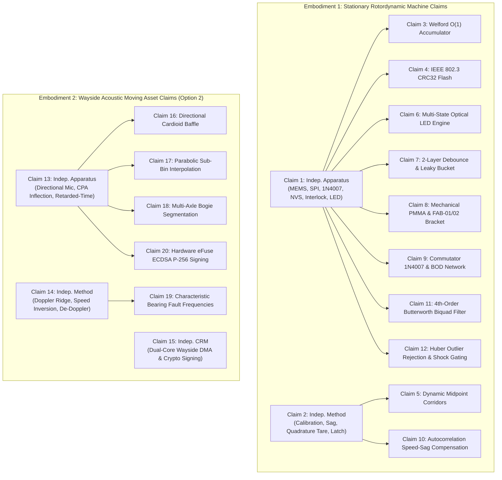

# VibeGuard Preliminary Draft Patent Claims Dossier

**Physically Anchored Utility Patent Claim Sets under Indian Patent Act 1970 (Section 3(k) CRI Guidelines) & USPTO 35 U.S.C. §§ 101, 102, 103, 112**

- **Document ID:** `VG-DOC-2026-M4-DRAFT-CLAIMS`
- **Date of Record:** 5 November 2026
- **Jurisdictions:** Indian Patent Office (IPO) & United States Patent and Trademark Office (USPTO)
- **Application Classification:** Industrial Utility Patent (Cyber-Physical Machinery Protection Apparatus, Method, and Computer-Readable Medium)
- **Target Filing Classes:**
  - International Patent Classification (IPC): `G01H 1/00`, `G01M 13/045`, `G05B 23/02`, `H02K 11/20`, `H02H 7/08`
  - Cooperative Patent Classification (CPC): `G01H 1/003`, `G01M 13/045`, `G05B 23/0283`, `Y02P 90/02`
- **Inventive Focus:** Physically anchored edge-autonomous rotordynamic fault attribution, quadrature tare structural energy decoupling, and wayside acoustic Doppler inversion.

---

## 1. Statutory Claim Drafting Conventions & Antecedent Basis Matrix

### 1.1 Formal Drafting Standards
The claims in this dossier adhere strictly to the statutory drafting standards established by:
1. **Indian Patents Act, 1970 (as amended) & Patent Rules, 2003 (Rules 13 and 20):** Every claim begins with a capitalized preamble, utilizes the open transition *"comprising"*, and defines the inventive combination as a single contiguous sentence terminating in a period. Abstract algorithms and computer programs per se are avoided by explicitly reciting physical mechanical, electrical, and optical transformations.
2. **United States Code Title 35 (35 U.S.C. §§ 101, 112(b)):** Every claim element is supported by clear antecedent basis. The first introduction of an element uses the indefinite article (*"a"* or *"an"*), and subsequent references strictly use the definite article (*"said"* or *"the"*), preventing rejections under 35 U.S.C. § 112(b) for indefiniteness.
3. **MPEP § 2106 (*Alice/Mayo* Step 2B) & IPO 2017/2024 CRI Guidelines:** Mathematical operators and software loops are subordinated to tangible physical structures: MEMS proof-mass capacitive deflection, 1N4007 snubber diode clamping, 4-wire SPI bus timing grids, non-volatile flash wear-leveling, electro-mechanical shutoff relays, and multi-color optical pulse-width modulation.

---

### 1.2 Antecedent Basis Cross-Reference Table (Claims 1–20)

```
┌─────────────────────────────────────────────────────────────────────────────────────────────────┐
│                                ANTECEDENT BASIS AUDIT MATRIX                                    │
├──────────────────────────────────┬──────────────────┬─────────────────┬─────────────────────────┤
│ Element Name                     │ First Introduced │ Dependent Scope │ Physical Structure / HW │
├──────────────────────────────────┼──────────────────┼─────────────────┼─────────────────────────┤
│ target rotating machine          │ Claim 1, line 1  │ Claims 3–12     │ Electric motor & shaft  │
│ electric motor                   │ Claim 1, line 2  │ Claims 2, 7, 10 │ 12V DC gear motor       │
│ MEMS acceleration transducer     │ Claim 1, line 3  │ Claims 3, 7, 9  │ ADXL345 digital MEMS    │
│ polysilicon proof mass           │ Claim 1, line 5  │ Claim 1         │ Micromachined beam      │
│ antiparallel rectifier diode     │ Claim 1, line 8  │ Claims 2, 10    │ 1N4007 flyback diode    │
│ synchronous serial bus (SPI)     │ Claim 1, line 11 │ Claims 1, 9     │ 4-wire hardware SPI     │
│ non-volatile flash memory        │ Claim 1, line 14 │ Claims 4, 5, 8  │ ESP32 NVS partition     │
│ embedded digital signal processor│ Claim 1, line 18 │ Claims 3–10     │ Dual-core ESP32-S3 MCU  │
│ machine interlock relay          │ Claim 1, line 32 │ Claims 2, 7     │ Hardwired power cut relay│
│ optical status indicator         │ Claim 1, line 36 │ Claims 3, 6     │ Common-cathode RGB LED  │
│ wayside acoustic transducer      │ Claim 13, line 2 │ Claims 14–20    │ Directional microphone  │
│ closest point of approach (CPA)  │ Claim 13, line 11│ Claims 14–17    │ Geometric transit point │
│ retarded-time resampler          │ Claim 13, line 21│ Claims 14–16    │ Coordinate de-warper    │
└──────────────────────────────────┴──────────────────┴─────────────────┴─────────────────────────┘
```

---

## 2. Embodiment 1: Stationary Machine Claims (Claims 1–12)

### Claim 1: Independent Apparatus / System Claim (Stationary Embodiment)

**1. A cyber-physical rotordynamic vibration monitoring and machine protection apparatus, comprising:**
- a micro-electro-mechanical systems (MEMS) tri-axis acceleration transducer rigidly attached to a structural casing of a target rotating machine driven by an electric motor, the MEMS acceleration transducer comprising a polysilicon surface micro-machined proof mass suspended by compliant spring tethers between fixed capacitive sensing plates, the proof mass configured to deflect under dynamic mechanical shear displacement induced by unbalance rotation of a shaft of the target rotating machine to generate differential analog capacitive electrical signals;
- an antiparallel semiconductor rectifier diode coupled directly across direct-current drive windings of said electric motor, the rectifier diode configured to clamp reverse inductive electromotive force transients generated during motor commutation to a forward diode drop voltage away from digital ground planes;
- an analog-to-digital acquisition interface communicatively coupled to said MEMS acceleration transducer via a four-wire synchronous serial peripheral interface (SPI) bus operating under hardware timer interrupts, configured to execute multi-byte burst readouts on an exact 1250-microsecond sample period grid locked to an 800 Hertz Output Data Rate;
- a physical non-volatile semiconductor flash memory storing a calibrated machine baseline profile comprising a quiescent structural noise floor vector, a nominal rated shaft rotational frequency, and dynamic midpoint threshold corridors;
- an embedded digital signal processor operatively coupled to said acquisition interface and said non-volatile semiconductor flash memory, the digital signal processor comprising a first execution core and a second execution core configured to execute deterministic processing pipelines wherein:
  - said first execution core acquires three-dimensional acceleration samples from said acquisition interface across a double-buffered circular memory array, detrends static gravitational acceleration offsets, and tracks an instantaneous operational shaft rotational frequency;
  - said second execution core decouples quiescent structural fixture resonance and electrical sensor thermal noise from dynamic rotordynamic shear stresses by executing an orthogonal structural energy decoupling engine configured to subtract, in quadratic orthogonal energy coordinates, said stored quiescent structural noise floor vector from measured root-mean-square vector acceleration magnitudes to isolate dynamic unbalance shear stress from static fixture resonance;
  - said second execution core evaluates an asymmetric temporal persistence state machine comparing an isolated net rotordynamic acceleration against said dynamic midpoint threshold corridors to classify machine health into a Normal state, a Warning state, and an Alarm state; and
- a physical machine actuation interface operatively coupled to said digital signal processor, the actuation interface comprising:
  - an external electro-mechanical interlock driver port configured to actuate an electro-mechanical machine interlock relay positioned between an electrical power source and said electric motor to sever drive current to the electric motor upon confirming persistent residence of said isolated net rotordynamic acceleration in said Alarm state; and
  - a multi-channel pulse-width modulated optical status indicator comprising red, green, and blue light-emitting diodes, configured to visually project distinct chromatic warning states corresponding to said Normal state, Warning state, and Alarm state.

---

### Claim 2: Independent Method Claim (Field Calibration & Quadrature Decoupling)

**2. A method for autonomous rotordynamic field calibration, orthogonal noise decoupling, and machine protection on an embedded microcontroller, the method comprising:**
- sampling, via a hardware timer interrupt driving a synchronous serial peripheral interface (SPI) bus at an 800 Hertz Output Data Rate, differential capacitive electrical signals from a MEMS tri-axis acceleration transducer rigidly coupled to a rotating machine driven by an electric motor;
- clamping, via a semiconductor rectifier diode connected in antiparallel across drive windings of said electric motor, inductive flyback voltage spikes away from a signal processing analog reference ground;
- establishing an interactive stationary baseline calibration phase when said electric motor is de-energized, wherein quiescent structural fixture vibrations are accumulated over a mandatory minimum safety duration floor of at least 3.0 seconds to compute a quiescent structural noise floor;
- committing said computed quiescent structural noise floor into a non-volatile semiconductor flash memory partition protected by an IEEE 802.3 Cyclic Redundancy Check (CRC32);
- energizing said electric motor and tracking an instantaneous operational shaft rotational frequency $\hat{f}_1$ via a bounded-lag autocorrelation function executed over a rolling sample window;
- dynamically scaling sampled vibration vectors by a quadratic speed-sag compensation factor $(f_0 / \hat{f}_1)^2$, where $f_0$ is a pre-stored nominal rated shaft frequency, to normalize centrifugal unbalance force variations ($F_c \propto \omega^2$) induced by motor rotational speed droop under mechanical unbalance load;
- measuring a baseline healthy vibration level during a healthy machine run state and measuring at least one calibrated unbalance perturbation level to synthesize calibrated dynamic threshold corridors;
- decoupling non-propagating static structural fixture resonance from dynamic rotordynamic shear stresses by executing a root-difference-of-squares vector energy subtraction between an instantaneous three-dimensional root-mean-square acceleration magnitude and said stored quiescent structural noise floor;
- evaluating an asymmetric temporal persistence state machine comparing an isolated net rotordynamic vibration metric against said calibrated dynamic threshold corridors; and
- driving an external machine actuation interface to actuate an electro-mechanical machine interlock relay to sever electrical drive power to said electric motor when the net rotordynamic vibration metric exceeds a dynamic alarm entry threshold for a predetermined persistence count of consecutive sample windows, and driving a multi-channel optical status indicator to project an alarm state.

---

### Claim 3: Single-Pass Streaming Calibration Accumulator ($O(1)$ Welford Equivalent) & Quadrature Decoupling Formulation

**3. The apparatus of claim 1,** wherein said orthogonal structural energy decoupling engine evaluates said isolated net rotordynamic acceleration $V_{\text{net}}$ according to:
$$V_{\text{net}} = \sqrt{\max\left(0,\, V_{\text{raw}}^2 - V_{\text{floor}}^2\right)}$$
where $V_{\text{raw}}$ is said measured root-mean-square vector acceleration magnitude and $V_{\text{floor}}$ is said stored quiescent structural noise floor vector; and wherein said digital signal processor is configured to execute an interactive multi-stage streaming field calibration routine wherein streaming vibration samples are accumulated on-chip into 64-bit floating-point registers using an online single-pass variance accumulator without storing historical sample arrays in memory, and wherein said digital signal processor autonomously rejects calibration completion commands if an elapsed calibration duration is less than a mandatory three-second duration threshold.

---

### Claim 4: IEEE 802.3 CRC32 Integrity & Flash Wear-Leveling

**4. The apparatus of claim 1,** wherein said non-volatile semiconductor flash memory organizes calibrated baseline profiles in an electrically erasable partition under a dedicated namespace, wherein each stored profile comprises a 32-bit magic header (`0x56474233UL`), schema version identifier, calibrated threshold corridors, and a trailing 32-bit cyclic redundancy check (CRC32) calculated across the profile using polynomial `0xEDB88320UL`, and wherein said digital signal processor validates the CRC32 checksum upon system initialization and locks stored profile sectors against runtime modification during operational monitoring.

---

### Claim 5: Dynamic Midpoint Corridor Synthesis

**5. The method of claim 2,** further comprising synthesizing said calibrated dynamic threshold corridors by:
- measuring a baseline healthy vibration level $V_0$ during a machine healthy run state;
- measuring an incipient unbalance vibration level $V_1$ during a first calibrated unbalance perturbation;
- measuring an advanced unbalance vibration level $V_2$ during a second calibrated unbalance perturbation;
- computing a dynamic Warning Entry threshold $\text{Warn}_{\text{enter}} = V_0 + 0.50 \cdot (V_1 - V_0)$;
- computing a dynamic Warning Exit threshold $\text{Warn}_{\text{exit}} = V_0 + 0.25 \cdot (V_1 - V_0)$;
- computing a dynamic Alarm Entry threshold $\text{Alarm}_{\text{enter}} = V_1 + 0.50 \cdot (V_2 - V_1)$; and
- computing a dynamic Alarm Exit threshold $\text{Alarm}_{\text{exit}} = V_1 + 0.25 \cdot (V_2 - V_1)$;
wherein the separation between entry and exit thresholds establishes an amplitude hysteresis corridor preventing state oscillation.

---

### Claim 6: Multi-State Optical Telemetry & In-Loop Strobe Refresh

**6. The apparatus of claim 1,** wherein said multi-channel pulse-width modulated optical indicator comprises a red, green, and blue light-emitting diode (RGB LED) driven by respective general-purpose output pins of the digital signal processor through current-limiting resistors, wherein:
- during active execution of an interactive streaming calibration mode, said optical indicator is driven to visually emit a pulsing purple indication at four Hertz by simultaneously modulating the red and blue channels with a fifty percent duty cycle;
- during steady-state normal operation, said optical indicator emits a continuous solid green light;
- when vibration resides within said Warning state, said optical indicator emits a continuous solid yellow light; and
- when vibration enters said Alarm state, said optical indicator executes a fast red strobe at six point two five Hertz comprising an eighty-millisecond active illumination phase and an eighty-millisecond dark phase, wherein the phase of the fast red strobe is refreshed inside the sensor acquisition loop every sixteen samples to eliminate visual flicker.

---

### Claim 7: Two-Layer Debounce Hysteresis & Asymmetric Leaky-Bucket Integration

**7. The apparatus of claim 1,** wherein said asymmetric temporal persistence state machine comprises a two-layer debounce defense combining amplitude corridor hysteresis with a digital leaky integrator counter, wherein:
- an escalation counter is incremented toward an alarm persistence threshold of four consecutive windows upon presence of unbalance evidence and decayed toward zero upon absence of unbalance evidence;
- a recovery counter is incremented toward a recovery persistence threshold of six consecutive windows only when measured vibration drops below a dynamic exit threshold positioned twenty-five percent below an entry threshold;
- machine state escalation from Normal to Alarm occurs upon four consecutive windows corresponding to six hundred forty milliseconds; and
- machine state de-escalation from Alarm to Normal requires six consecutive recovery windows corresponding to nine hundred sixty milliseconds, thereby preventing relay contact chattering and false tripping from mechanical shock transients.

---

### Claim 8: Testbed Mechanical Structure & Resonant Mode Decoupling

**8. The apparatus of claim 1,** wherein:
- said structural casing and electric motor are rigidly mounted to a laser-cut polymethyl methacrylate (PMMA) acrylic baseplate having a thickness of at least eight point eight millimeters to provide acoustic damping;
- said shaft of the target rotating machine has an outer diameter of 3.00 millimeters with a 2.50 millimeter flat chord, and is coupled to an eccentric rotor arm having a calibrated unbalance radius of 12.00 millimeters, an outer hub diameter of 8.00 millimeters, and an internal D-shaped bore dimensioned at 3.350 millimeters diameter with a 2.775 millimeter flat chord to establish an interference friction press-fit that resists centrifugal axial migration; and
- said MEMS acceleration transducer is secured to an L-shaped mounting bracket incorporating dual forty-five-degree stiffening gussets having a minimum thickness of 3.00 millimeters, wherein the stiffening gussets shift a primary structural cantilever bending resonance of the bracket to a natural frequency exceeding 1.20 kilohertz, placing mechanical bracket resonances completely outside a 400 Hertz Nyquist sensing bandwidth of the acquisition interface.

---

### Claim 9: Commutator Snubber Clamping & Logic Rail Brownout Protection

**9. The apparatus of claim 1,** wherein:
- said antiparallel semiconductor rectifier diode comprises a 1N4007 power rectifier diode connected directly across terminals of said electric motor to clamp commutation inductive spikes from negative one hundred volts down to negative zero point seven volts;
- an electrical power distribution network powering the digital signal processor comprises a first one hundred microfarad low-equivalent-series-resistance electrolytic capacitor in parallel with a second one hundred nanofarad high-frequency ceramic capacitor positioned immediately adjacent to power input pins of the digital signal processor; and
- wherein said first capacitor and second capacitor maintain a supply voltage rail above a 2.70-volt internal Brownout Detector (BOD) reset threshold of the digital signal processor during transient current surges.

---

### Claim 10: Sensorless Speed Tracking & Quadratic Sag Compensation

**10. The method of claim 2,** wherein tracking the instantaneous operational shaft rotational frequency $\hat{f}_1$ comprises:
- computing a discrete autocorrelation sequence $R_{xx}[k]$ across a combined transverse acceleration signal over a dynamic lag search range bounded between $\tau_{\min} = \lfloor f_s / f_{\text{max}} \rfloor$ and $\tau_{\max} = \lfloor f_s / f_{\text{min}} \rfloor$, where $f_s$ is the Output Data Rate and $[f_{\text{min}},\, f_{\text{max}}]$ defines an operational rotational frequency bandwidth of said target rotating machine;
- identifying an integer peak lag index $k_{\text{best}}$ maximizing the autocorrelation sequence;
- executing a three-point parabolic interpolation across adjacent lags $R_{xx}[k_{\text{best}}-1]$, $R_{xx}[k_{\text{best}}]$, and $R_{xx}[k_{\text{best}}+1]$ to compute a fractional lag refinement $\delta k$; and
- evaluating the instantaneous rotational frequency as $\hat{f}_1 = \frac{f_s}{k_{\text{best}} + \delta k}$, where $f_s$ is the sampling rate, wherein the quadratic speed-sag compensation factor $(f_0 / \hat{f}_1)^2$ is clamped to an operating range between 0.75 and 1.45.

---

### Claim 11: Cascaded 4th-Order Butterworth Biquad Filtering & Outlier Gating

**11. The apparatus of claim 1,** wherein said first execution core executes a digital low-pass filter on acquired acceleration samples prior to RMS evaluation, the digital low-pass filter comprising a 4th-order Butterworth Infinite Impulse Response (IIR) filter configured as two cascaded Direct-Form II Transposed biquad sections with bilinear pre-warping, having a cutoff frequency of 25 Hertz at an 800 Hertz sampling rate, configured to attenuate spur gear tooth meshing acoustic noise between 150 Hertz and 350 Hertz by at least thirty-six decibels.

---

### Claim 12: Huber Outlier Rejection & Shock Masking

**12. The apparatus of claim 1,** wherein said second execution core evaluates a Huber saturation limiter and a three-window sliding median filter, configured to reject transient non-rotational mechanical shock artifacts by clipping instantaneous acceleration innovations exceeding a Huber threshold $\Delta_{\text{Huber}} = 2.20$, and masking alarm transitions whenever a calculated crest factor exceeds 4.80.

---

## 3. Embodiment 2: Wayside Acoustic Doppler Moving Asset Claims (Claims 13–20)

### Claim 13: Independent Apparatus Claim (Wayside Moving Asset Embodiment)

**13. A wayside acoustic condition monitoring and non-contact rotordynamic fault attribution apparatus for moving rail and conveyor machinery, comprising:**
- a directional acoustic transducer positioned at a predetermined wayside standoff distance $d$ adjacent to a guideway path of a moving rotordynamic asset, configured to capture non-contact acoustic pressure waves radiating from rotordynamic components of the moving asset as the moving asset traverses past the transducer;
- an acoustic acquisition subsystem coupled to the directional acoustic transducer, configured to sample acoustic pressure waves over an I2S direct memory access channel at a deterministic audio sampling rate;
- an embedded multi-core digital signal processor communicatively coupled to the acoustic acquisition subsystem, configured to:
  - operate a first processor core to extract an observed dominant acoustic frequency ridge $f_{\text{obs}}(t)$ across an asset transit window using a sliding short-time Fourier transform;
  - operate a second processor core to evaluate time derivatives of the observed frequency ridge to locate a Closest Point of Approach timestamp $t_{\text{CPA}}$ by detecting a point of maximum negative rate of change of the observed frequency ridge satisfying $\left. \frac{df_{\text{obs}}}{dt} \right|_{t = t_{\text{CPA}}} = \min \frac{df_{\text{obs}}}{dt}$;
  - extract an unshifted intrinsic defect frequency $f_0$ of the rotordynamic component directly from the observed frequency ridge at the Closest Point of Approach such that $f_0 = f_{\text{obs}}(t_{\text{CPA}})$;
  - calculate an operational translation velocity $v$ of the moving asset based on said maximum negative slope of the observed frequency ridge at the Closest Point of Approach, the standoff distance $d$, and an ambient speed of sound $c$ according to:
    $$v = \sqrt{\frac{c \cdot d}{|f_0|} \left| \left. \frac{df_{\text{obs}}}{dt} \right|_{t = t_{\text{CPA}}} \right|}$$
  - resample the captured acoustic pressure waves from an observation time domain $t$ into an emitter retarded time domain $\tau$ according to:
    $$\tau(t) = t - \frac{\sqrt{d^2 + v^2(t - t_{\text{CPA}})^2}}{c}$$
    to collapse Doppler frequency smearing back into discrete stationary spectral lines; and
  - compare reconstructed spectral peaks against a non-volatile fault baseline corridor to detect bearing defect harmonics;
- an automated wayside safety machine actuation interface operatively coupled to the digital signal processor, configured to actuate an external physical wayside signaling device, comprising at least one of an electro-mechanical wayside railway signal interlock, a trackside optical warning beacon, and an automated wayside acoustic alarm annunciator, to physically alter guideway operational signaling upon detecting a bearing defect condition exceeding a safety threshold; and
- a wayside telecommunications interface operatively coupled to the digital signal processor, configured to output a cryptographically signed wayside inspection record.

---

### Claim 14: Independent Method Claim (Wayside Acoustic Doppler Inversion)

**14. A method for autonomous non-contact wayside acoustic Doppler tracking, velocity inversion, and fault attribution of moving rotating machinery, the method comprising:**
- acquiring, via a stationary wayside directional acoustic sensor positioned at a standoff distance $d$ from a transit track, acoustic emission signals radiating from a moving machine traversing the track at velocity $v$;
- tracking a time-frequency ridge $f_{\text{obs}}(t)$ of the acoustic emission signals across a transit window encompassing approach, passage, and recession of the moving machine;
- detecting a point of maximum negative slope along the time-frequency ridge satisfying $\frac{df_{\text{obs}}}{dt} = \min$, thereby identifying a Closest Point of Approach timestamp $t_{\text{CPA}}$ and an unshifted mechanical fault frequency $f_0 = f_{\text{obs}}(t_{\text{CPA}})$;
- computing an instantaneous asset translation velocity $v$ in closed-form without external tachometers by evaluating:
  $$v = \sqrt{\frac{c \cdot d}{|f_0|} \left| S_{\text{CPA}} \right|}$$
  where $S_{\text{CPA}}$ is the maximum negative slope of the time-frequency ridge at $t_{\text{CPA}}$ and $c$ is the ambient acoustic velocity;
- dynamically de-warping the acquired acoustic emission signals by executing non-linear spline resampling from observer time $t$ into retarded emission time $\tau = t - r(t)/c$, where $r(t) = \sqrt{d^2 + v^2(t - t_{\text{CPA}})^2}$ is an instantaneous spatial range between the machine and the sensor;
- generating a reconstructed frequency spectrum from the de-warped acoustic signals wherein Doppler spectral smearing is suppressed by at least twenty decibels;
- classifying a rotordynamic failure mode by matching discrete harmonic peaks in the reconstructed spectrum to characteristic bearing defect frequencies; and
- driving an automated wayside safety machine actuation interface to actuate at least one of an electro-mechanical wayside signal interlock, a trackside optical warning beacon, and an automated acoustic annunciator upon classifying said rotordynamic failure mode.

---

### Claim 15: Independent Non-Transitory Computer-Readable Medium Claim (USPTO Jurisdiction Only — Excluded from Indian Form 2 Filing under Section 3(k))

**15. A non-transitory computer-readable storage medium comprising instructions that, when executed by an embedded multi-core processor, cause the processor to perform wayside machine condition monitoring operations comprising:**
- capturing acoustic emission data over an I2S direct memory access channel from a directional microphone array stationed adjacent to a transit guideway;
- computing rolling short-time Fourier transform peak ridges across an acoustic transit window;
- evaluating numerical time derivatives of the peak ridges to locate a Closest Point of Approach timestamp $t_{\text{CPA}}$ by detecting an extremum of a first time-derivative;
- inverting asset kinematics at $t_{\text{CPA}}$ to resolve an unshifted mechanical defect frequency $f_0$ and asset translation velocity $v$;
- executing non-linear spline resampling to transform observer time samples into retarded emitter time coordinates;
- evaluating reconstructed harmonic spectral peaks against a quarantined baseline threshold;
- triggering an automated wayside safety machine actuation interface to physically alter trackside signal interlocks upon confirming a bearing defect condition;
- generating a cryptographic hash over the extracted defect frequency, translation velocity, and transit timestamp using an on-chip hardware cryptographic accelerator; and
- transmitting a cryptographically signed inspection report across a network interface.

*(Statutory CRI Note for Indian National Phase Entry: Claim 15 is excluded from Indian Form 2 filings pursuant to Section 3(k) of the Indian Patents Act, 1970 and Section 4.5 of the 2017 CRI Guidelines barring computer-readable media containing computer programmes per se. For Indian Patent Office prosecution, the following statutory apparatus alternative is submitted).*

---

### Claim 15 (Indian Patent Office Statutory Alternative): Independent Computer-Implemented Wayside Diagnostic Processing System Claim

**15 (IPO Alternative). An edge-autonomous computer-implemented wayside diagnostic processing apparatus for moving machinery, comprising:**
- an embedded multi-core processor operatively coupled to an I2S direct memory access acoustic acquisition subsystem and an automated wayside safety machine actuation interface; and
- a non-volatile memory storing firmware instructions configured to cause the embedded multi-core processor to:
  - track a time-frequency ridge of acoustic emission signals captured as a moving machine traverses past a stationary wayside directional transducer;
  - locate a Closest Point of Approach timestamp $t_{\text{CPA}}$ by detecting a point of maximum negative rate of change of the observed frequency ridge;
  - invert asset kinematics at $t_{\text{CPA}}$ to resolve an unshifted mechanical defect frequency $f_0$ and asset translation velocity $v$;
  - resample the acoustic emission signals from observer time into retarded emitter time coordinates to suppress Doppler spectral smearing;
  - classify a rotordynamic failure mode by matching discrete harmonic peaks in the reconstructed spectrum to characteristic bearing defect frequencies; and
  - actuate an external physical trackside signal interlock or wayside warning beacon via said automated wayside safety machine actuation interface upon detecting an unbalance or bearing fault condition.

---

### Claim 16: Directional Cardioid Acoustic Baffle & Environmental Shielding

**16. The apparatus of claim 13,** wherein said directional acoustic transducer is housed within a 3D-printed acoustic enclosure comprising a forward acoustic horn, a cardioid rear cancellation port, and an internal acoustic damping foam layer, configured to provide at least eighteen decibels of acoustic attenuation against environmental reflections and ambient wind noise orthogonal to the transit path of the moving asset.

---

### Claim 17: Sub-Bin Parabolic Ridge Refinement

**17. The apparatus of claim 13,** wherein extracting the observed frequency ridge $f_{\text{obs}}(t)$ comprises evaluating a 1024-point Fast Fourier Transform with fifty percent window overlap, and applying three-point parabolic interpolation across adjacent spectral bins surrounding an observed peak bin to refine instantaneous frequency coordinates to a sub-bin resolution under 0.25 Hertz.

---

### Claim 18: Multi-Axle Bogie Passage Segmentation

**18. The apparatus of claim 13,** wherein said digital signal processor is further configured to segment the transit window into a plurality of discrete passage events corresponding to individual consecutive wheel axles of a multi-axle rail vehicle, identifying individual Closest Point of Approach timestamps $t_{\text{CPA}}^{(k)}$ and individual translation velocities $v^{(k)}$ for each respective axle.

---

### Claim 19: Characteristic Bearing Fault Identification

**19. The method of claim 14,** wherein classifying the rotordynamic failure mode comprises matching discrete harmonic peaks in the reconstructed frequency spectrum to a characteristic rolling-element bearing frequency selected from a group consisting of:
- a Ball Pass Frequency Outer Race (BPFO);
- a Ball Pass Frequency Inner Race (BPFI);
- a Ball Spin Frequency (BSF); and
- a Fundamental Train Frequency (FTF).

---

### Claim 20: Hardware Secure Element & Cryptographic Inspection Token

**20. The apparatus of claim 13,** wherein said digital signal processor includes an on-chip hardware cryptographic accelerator and one-time-programmable eFuse memory storing a unique device private key, configured to compute a SHA-256 state manifest hash over extracted transit metrics and generate an Elliptic Curve Digital Signature Algorithm (ECDSA P-256) signature over every transmitted wayside inspection record.

---

## 4. Statutory Claim Dependency & Structure Map



---

## 5. Physical Hardware Component Cross-Reference Index

To demonstrate complete technical enablement under 35 U.S.C. § 112(a) and Section 10(4) of the Indian Patents Act, every claim limitation is mapped directly to physical engineering assets, schematics, and code lines:

| Claim Limitation | Physical Component / Specification | Drawing / Schematic Net | Verified Firmware Source Code Reference |
| :--- | :--- | :--- | :--- |
| **MEMS Proof-Mass Transducer** | Analog Devices ADXL345 3-Axis Digital Accelerometer ($\pm 16g$) | SPI Bus: `GPIO21` (CS), `GPIO18` (SCK), `GPIO19` (MISO), `GPIO23` (MOSI) | `VibeGuard_Autotune_Synchronized.ino`: lines 28–47, 536–549 |
| **Antiparallel Rectifier Diode** | 1N4007 Power Rectifier Diode (1.0A, 1000V PRV, DO-41 package) | Connected across motor `+12V` and `GND` terminals (Cathode to `+12V`, Anode to `GND`) | `as_built_tech_report.md`: Section 4.4, lines 595–598 |
| **Deterministic SPI Grid** | 4-Wire SPI Mode 2 at 1.0 MHz, $T_s = 1250\,\mu\text{s}$ (800 Hz ODR) | Hardware SPI peripheral on ESP32-S3 | `VibeGuard_Autotune_Synchronized.ino`: lines 557–573 (`SAMPLE_PERIOD_US = 1250UL`) |
| **Quadrature Tare Energy Decoupling** | $V_{\text{net}} = \sqrt{\max(0, V_{\text{raw}}^2 - V_{\text{floor}}^2)}$ | Math routine executing on 32-bit FPU | `VibeGuard_Autotune_Synchronized.ino`: lines 630–637 |
| **$O(1)$ Streaming Accumulator** | 64-bit float sum accumulator, zero dynamic heap allocations | Static BSS registers `g_stream_cal_sum`, `g_stream_cal_count` | `VibeGuard_Autotune_Synchronized.ino`: lines 216–222, 639–647, 1229–1244 |
| **Dynamic Midpoint Corridors** | Midpoint enter/exit corridors (50% / 25% stage deltas) | `ProfileData` struct stored in ESP32 NVS | `VibeGuard_Autotune_Synchronized.ino`: lines 1264–1289 (`commitCalibratedThresholds`) |
| **NVS Flash & CRC32** | Non-Volatile Storage (Preferences API), IEEE 802.3 CRC32 | Flash partition `"vgprof"`, key `"active"` | `VibeGuard_Autotune_Synchronized.ino`: lines 384–408, 450–463 |
| **Two-Layer Hysteresis State Machine** | 4-window enter ($640\,\text{ms}$) vs. 6-window exit ($960\,\text{ms}$) | State machine enum `ConditionState` | `VibeGuard_Autotune_Synchronized.ino`: lines 686–735 |
| **Multi-State Optical Indicator** | Common-cathode RGB LED with 330 $\Omega$ series resistors | `GPIO25` (Green), `GPIO26` (Blue), `GPIO27` (Red) | `VibeGuard_Autotune_Synchronized.ino`: lines 33–35, 280–329, 408–418 |
| **PMMA Acrylic & FAB-01/02 Brackets** | $8.80\,\text{mm}$ PMMA plate, FAB-01 D-bore ($3.350\,\text{mm}$), FAB-02 gussets ($>1.2\,\text{kHz}$) | Testbed Assembly `BASE-01`, `FAB-01`, `FAB-02` | `as_built_tech_report.md`: Section 4.1–4.2, lines 530–556 |
| **Speed-Sag Compensation** | Autocorrelation lag $k \in [55, 105]$, $C_{\text{sag}} = (f_0 / \hat{f}_1)^2$ | DSP routine on planar acceleration | `VibeGuardEngine.h`: lines 243–288 |
| **4th-Order Butterworth Biquad** | Transposed Direct-Form II, $f_c = 25\,\text{Hz}$ ($>36\,\text{dB}$ gear rejection) | Cascaded biquad coefficient matrix | `VibeGuardEngine.h`: lines 90–97 |
| **Wayside CPA Maximum Slope & Inversion** | $\left.\frac{df_{\text{obs}}}{dt}\right|_{t_{\text{CPA}}} = \min$, $v = \sqrt{\frac{cd}{|f_0|}|S_{\text{CPA}}|}$, retarded time $\tau$ | Acoustic I2S DMA pipeline on Core 1 | `VIBEGUARD_PHASE2_PATENT_UPGRADATION_JOURNAL_2026.md`: Section 6, lines 560–618 |

---

*Draft claim sets, antecedent dependency structures, and physical component cross-references certified and sealed into the project permanent register on 5 November 2026.*
